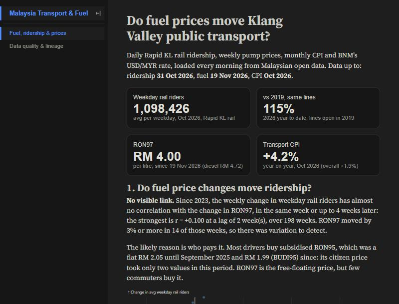

# Open Data ELT Pipeline

Work in progress. Ingests Malaysian open data (data.gov.my, DOSM, BNM) with dlt, models it with dbt, serves a dashboard. Sources: [SOURCES.md](SOURCES.md).



## Run (so far)

```bash
uv sync
uv run elt probe              # check sources still match SOURCES.md
uv run elt load --backfill    # full history from parquet bulk files + BNM since 2017 (~2.5 min)
uv run elt load               # incremental: API rows since last load minus lookback (~40 s)
uv run elt transform          # dbt source freshness + dbt build (seeds, models, 69 tests)
uv run elt docs               # dbt docs site -> dbt/target/index.html
npm ci --prefix dashboard     # once: Observable Framework (Node 20+)
uv run elt site               # dashboard + dbt docs -> dashboard/dist (static, for GitHub Pages)
npm run dev --prefix dashboard  # live preview at http://127.0.0.1:3000
uv run pytest                 # offline tests incl. a full dbt build on synthetic data (-m live for real APIs)
```

Add `--target motherduck` to `load`, `transform` or `docs` to use MotherDuck instead of the local file (needs `MOTHERDUCK_TOKEN` in `.env`).

## Scheduled pipeline

`.github/workflows/pipeline.yml` runs daily at 09:30 MYT: `elt load` → `elt transform` (freshness, build, 69 tests) on MotherDuck → `elt site` → GitHub Pages (dashboard at `/`, dbt docs at `/dbt-docs/`). dbt results are kept as a run artifact. Any failed step sends a Telegram message with the error lines and a link to the run. Manual runs can tick **backfill**.

Repo secrets: `MOTHERDUCK_TOKEN` (required), `TELEGRAM_BOT_TOKEN` + `TELEGRAM_CHAT_ID` (optional, alerts).

`ci.yml` runs lint and the offline tests on every push.

Raw tables land in `data/warehouse.duckdb`, schema `raw`; dbt writes `staging`, `intermediate`, `marts` (star schema: `dim_date`, `dim_service`, `dim_cpi_division`, `fct_ridership_daily`, `fct_fuel_price_daily`, `fct_fx_daily`, `fct_cpi_monthly`, plus `mart_transport_weekly` / `mart_transport_monthly` for the dashboard).
