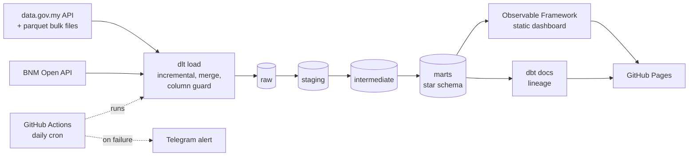

# Open Data ELT Pipeline

**A daily, tested ELT pipeline for Malaysian open data: dlt loads public transport ridership, fuel prices, CPI and BNM exchange rates into DuckDB/MotherDuck, dbt models them into a star schema, and a static dashboard asks whether fuel prices move public transport use. Running cost: RM 0.**

**Live dashboard:** [zeeqy.github.io/open-data-elt-pipeline](https://zeeqy.github.io/open-data-elt-pipeline/) (rebuilt daily by the pipeline)

[](https://github.com/zeeqy/open-data-elt-pipeline/actions/workflows/ci.yml)


Docs: [Architecture](docs/ARCHITECTURE.md) · [Incident drill](docs/INCIDENT.md) · [Sources](SOURCES.md)

## Problem

Malaysia publishes useful open data (data.gov.my, OpenDOSM, Bank Negara), but each dataset updates on its own schedule, has its own quirks and occasionally changes shape. Answering a question that joins them, like *"do fuel price changes move rail ridership?"*, needs a pipeline that keeps them fresh, catches breaking changes and is cheap enough to leave running.

## Data

| Dataset | Publisher | Grain | History |
|---|---|---|---|
| Public transport ridership | Prasarana / KTMB via data.gov.my | daily, 14 rail lines and bus networks | 2019 → |
| Retail fuel prices (RON95, RON97, diesel, BUDI95) | MOF via data.gov.my | weekly | 2017 → |
| Consumer Price Index by division | DOSM | monthly | 1980 → |
| MCOICOP lookup (division names) | DOSM | lookup | |
| USD/MYR exchange rate | BNM Open API | business day | 2017 → |

All free, no key needed, CC BY 4.0. Endpoints, quirks and the load policy are in [SOURCES.md](SOURCES.md).

## Key findings

The dashboard text is computed from the data at each build; these are the numbers on 2026-11-24.

1. **Fuel prices do not visibly move weekday rail ridership.** Since 2023, weekly RON97 changes and weekly changes in weekday Rapid KL rail riders have |r| ≤ 0.10 at lags of 0 to 4 weeks (~200 weeks, 14 of them with RON97 moves of 3%+). Most drivers buy subsidised RON95, which had only two prices in that period (RM 2.05, then RM 1.99 under BUDI95 from 30 Sep 2025).
2. **Transport inflation follows fuel, weakly since 2022.** 2018–2021: transport CPI tracked RON95 almost exactly (r = 0.995). Since 2022: it follows RON97 (r = 0.83) but with a small slope, about 0.06 points of transport CPI inflation per point of RON97 inflation.
3. **Rail ridership is above pre-COVID levels.** On the 4 lines that ran in January 2019, average weekday ridership in 2026 is 115% of 2019 (low point: 29% in 2021). Weekend riders rose from 58% to 65% of weekday riders.

Correlation, not causation; holiday weeks and new lines add noise. Details on the dashboard.

## What the pipeline does

- **Incremental, idempotent loads (dlt).** First run or `--backfill` reads the parquet bulk files; daily runs ask the API only for rows since the last load minus a revision window (35 days, 100 for CPI), within data.gov.my's 4 requests/minute limit. Merging on primary keys means reruns add 0 rows. dlt keeps its state in the warehouse, so a fresh CI runner continues incrementally.
- **Schema drift handled on purpose.** New columns are added automatically; a missing column the models need, or a changed data type, stops the load before anything is written.
- **Star schema (dbt).** Staging → intermediate (unpivot, `ASOF JOIN` fill-forward) → `dim_date`, `dim_service`, `dim_cpi_division`, `fct_ridership_daily`, `fct_fuel_price_daily`, `fct_fx_daily`, `fct_cpi_monthly`, plus two wide marts for the dashboard.
- **Tested.** Source freshness + 50 dbt tests (unique, not_null, relationships, accepted values, plausible prices, unknown services, a unit test) and 25 pytest tests, including a full `dbt build` on synthetic data so CI never calls the APIs.
- **Scheduled with alerts.** GitHub Actions runs load → transform → site every morning against MotherDuck and publishes to GitHub Pages; any failed step sends a Telegram message with the error lines and run link.
- **Incident drill.** `uv run elt drill` simulates the source renaming a column and shows both layers catching it ([INCIDENT.md](docs/INCIDENT.md)).

## Stack

Python 3.12 · uv · dlt 1.32 · DuckDB 1.5 · MotherDuck (Lite, free) · dbt-core 1.12 + dbt-duckdb · Observable Framework 1.13 (Observable Plot) · GitHub Actions · GitHub Pages · Telegram Bot API · pytest · ruff

## Architecture



Warehouse = MotherDuck in the scheduled job when the token secret is set, a local DuckDB file otherwise (same SQL). More in [docs/ARCHITECTURE.md](docs/ARCHITECTURE.md), lineage graph in [docs/lineage.jpg](docs/lineage.jpg).

## How to run

Needs [uv](https://docs.astral.sh/uv/) and, for the dashboard, Node.js 20+.

```bash
uv sync
uv run elt probe                # check every source still matches SOURCES.md
uv run elt load --backfill      # full history into data/warehouse.duckdb (~2.5 min, mostly BNM)
uv run elt load                 # daily incremental run (~40 s, rate-limited API)
uv run elt transform            # dbt source freshness + build + tests
uv run elt drill                # incident drill on a copy of the warehouse
npm ci --prefix dashboard       # once
uv run elt site                 # dashboard + dbt docs -> dashboard/dist
npm run dev --prefix dashboard  # live preview at http://127.0.0.1:3000
uv run pytest                   # offline tests (add -m live for real-API tests)
```

Add `--target motherduck` to `load`, `transform` or `site` to use MotherDuck (put `MOTHERDUCK_TOKEN` in `.env`, see `.env.example`).

**Scheduled run** (`.github/workflows/pipeline.yml`, 09:30 MYT daily, or manual with a *backfill* tick box). Repo secrets (all optional): `MOTHERDUCK_TOKEN` (without it the run uses a local DuckDB file in the runner and reloads from the parquet bulk files), `TELEGRAM_BOT_TOKEN` + `TELEGRAM_CHAT_ID` (without them the alert is printed in the log). Settings → Pages → Source: GitHub Actions (until then the site is built but the deploy job is skipped with a notice).

## Limitations

- **Correlation only.** The fuel→ridership check looks for an obvious effect in weekly changes; it is not a causal model (no controls for holidays, school terms, fares or new lines).
- **Ridership lags ~3 weeks** at the source, so the dashboard is never up to the day.
- **Hand-written service names.** The source only gives column names like `rail_lrt_kj`; names, operators and the "Rapid KL rail" flag come from a small seed file (`dbt/seeds/ridership_services.csv`). A test fails if a new, unknown service appears.
- **Small data.** ~11 MB warehouse; the design choices (merge on keys, revision window, tests) matter more than scale here.
- **Cloud path is new.** The MotherDuck target and the scheduled workflow are built and tested against local DuckDB; MotherDuck compute use will be measured after the first cloud runs.
- **npm audit** reports 4 issues (1 low, 3 moderate) in Observable Framework's build-time dependencies; the published site is static files only.

## Data attribution

Data from data.gov.my and OpenDOSM under CC BY 4.0, and the Bank Negara Malaysia Open API.
