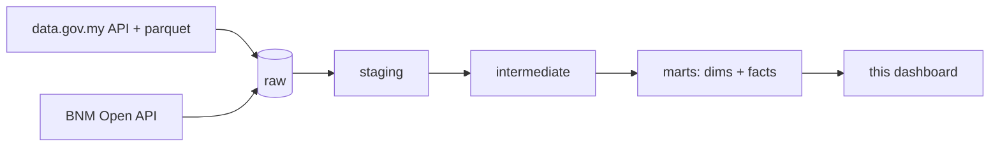

```js
const meta = FileAttachment("data/meta.json").json();
const dayName = d3.utcFormat("%-d %b %Y");
```

# Data quality & lineage

Every morning a GitHub Actions job loads the sources with dlt, then dbt checks freshness, builds the star schema and runs its tests. This page is rebuilt from that run.

<div class="grid grid-cols-2">
  <div class="card">
    <h2>dbt tests in the last build</h2>
    ${meta.dbt_tests.available
      ? html`<span class="big">${meta.dbt_tests.by_status.pass ?? 0} / ${meta.dbt_tests.total} passed</span>
        <div class="muted">data tests + unit tests, ${dayName(new Date(meta.dbt_tests.generated_at))}</div>
        ${meta.dbt_tests.failed.length ? html`<p>Failed: ${meta.dbt_tests.failed.join(", ")}</p>` : ""}`
      : html`<span class="muted">No dbt run results found for this build.</span>`}
  </div>
  <div class="card">
    <h2>Newest data per source</h2>
    ${Inputs.table(Object.entries(meta.latest).map(([source, latest]) => ({source, latest})), {select: false})}
  </div>
</div>

## What is checked

- **Source freshness** (`dbt source freshness`): ridership warns after 35 days (it is published about 3 weeks late), fuel after 10, BNM after 5, CPI after 90.
- **Keys**: unique + not null on every table's grain, e.g. one row per day per service in `fct_ridership_daily`.
- **Relationships**: every fact row points to a row in `dim_date`, `dim_service` or `dim_cpi_division`.
- **Accepted values** and two custom checks: fuel prices between RM 1 and RM 10, and every ridership column is a known service.
- **Unit test**: weekly fuel prices fill forward to each day until the next price.
- **Schema drift at load time**: a renamed or missing column stops the load before anything is written; new columns are added automatically.

## Lineage

The full model graph, column docs and tests are in the **[dbt docs site](./dbt-docs/index.html)** (open the graph icon, bottom right).


