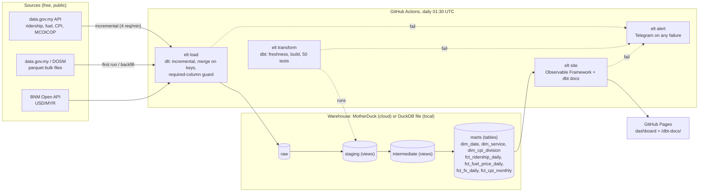

# Architecture

## Data flow

1. **Extract + load** (`src/open_data_elt/`, dlt): the first run, or `elt load --backfill`, reads the parquet bulk files (no rate limit). Daily runs ask the API only for rows since the last loaded date minus a revision window (35 days; 100 for CPI). Every table merges on its primary key, so reruns add nothing. dlt keeps its cursor state inside the warehouse, so a fresh CI runner continues where the last one stopped.
2. **Transform** (`dbt/`): staging cleans and types each source; intermediate unpivots ridership and fills weekly prices and weekday FX rates forward to every day (DuckDB `ASOF JOIN`); marts are a star schema plus two wide tables for the dashboard.
3. **Test**: dbt source freshness, 50 data and unit tests (keys, relationships, accepted values, plausible prices, unknown services, fill-forward logic). The load step has its own guard for missing columns and type changes ([INCIDENT.md](INCIDENT.md)).
4. **Serve** (`dashboard/`): Observable Framework builds a static site. Python data loaders query the marts at build time; all numbers in the text are computed from the data. dbt's single-file docs site (lineage graph) is published under `/dbt-docs/`.

## Why these tools

| Choice | Alternative | Why |
|---|---|---|
| dlt | plain `requests` + SQL | Incremental state, merge, schema evolution and contracts built in; state stored in the warehouse |
| DuckDB + MotherDuck | BigQuery sandbox | Same engine locally and in the cloud, so the same dbt SQL runs on both; sandbox tables expire after 60 days |
| dbt | SQL scripts | Lineage, tests, freshness, docs site for free |
| GitHub Actions cron | Dagster | Nothing to host; dbt docs already show lineage. Dagster would add a service for one daily job |
| Observable Framework | Evidence, Streamlit | Static output for GitHub Pages. Evidence's static build is deprecated (its new CLI needs a server); Streamlit would need a server too |
| Telegram | Email, Slack | Free bot API, instant on the phone |

## Running cost

| Component | Plan | Limit | This project uses | Cost |
|---|---|---|---|---|
| GitHub Actions | Public repo | Free for public repositories | 1 job/day + CI on push | RM 0 |
| GitHub Pages | Public repo | 1 GB site, 100 GB/month bandwidth | 3.4 MB site | RM 0 |
| MotherDuck | Lite (no credit card) | 10 GB storage, 10 compute-hours/month | ~11 MB warehouse; compute to be measured after the first cloud runs | RM 0 |
| data.gov.my, OpenDOSM, BNM APIs | Public | 4 requests/min (data.gov.my) | ~4 data.gov.my calls + 1–2 BNM calls per day | RM 0 |
| Telegram Bot API | Free | n/a | Only on failure | RM 0 |
| **Total** | | | | **RM 0 / month** |

Limits checked 2026-11-23 on each provider's pricing page. MotherDuck Lite needs no credit card, so nothing can be charged; the pricing page does not say exactly what happens at the compute limit, so if a run were refused the job would fail and the Telegram alert would say so.

## Local vs cloud

Every command takes `--target local|motherduck`. Local uses `data/warehouse.duckdb`; tests and CI use small synthetic data and never call the APIs. The scheduled workflow is the only thing that writes to MotherDuck.
